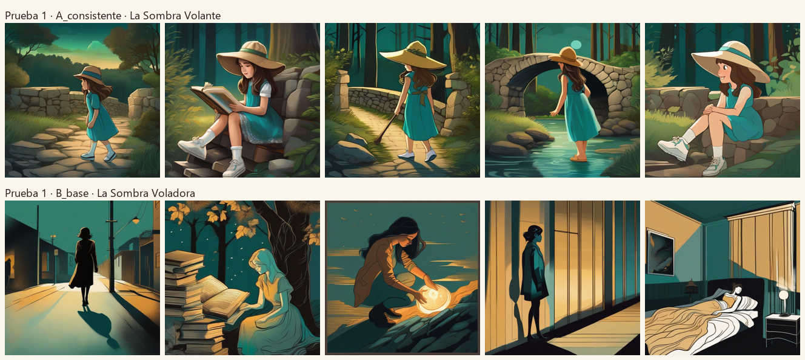
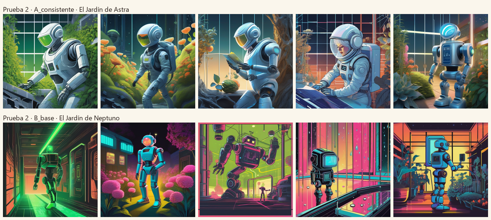
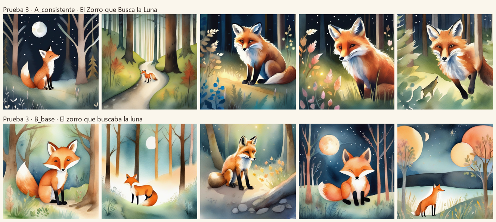

# Evidencias de pruebas — Storybook

Generado el 2026-11-23 11:55. 3 prueba(s), 6 cuento(s).

## Hardware y versiones

| Elemento | Valor |
| --- | --- |
| sistema | Windows-11-10.0.26300-SP0 |
| cpu | Intel64 Family 6 Model 186 Stepping 2, GenuineIntel |
| gpu | NVIDIA GeForce RTX 4050 Laptop GPU |
| vram_gb | 6.0 |
| python | 3.12.14 |
| torch | 2.14.1+cu126 |
| cuda_disponible | True |
| transformers | 5.23.0 |
| diffusers | 0.43.0 |
| accelerate | 1.15.0 |
| bitsandbytes | 0.50.2 |
| piper-tts | 1.8.0 |
| pygame | 2.6.1 |

RAM: completar a mano (el programa no la mide).

## Prueba 1 — Misterio

**Idea:** Una niña se obsesiona con saber por qué su sombra puede volar y vivirá toda su vida buscando la respuesta



| Configuración | Título | Guion (s) | Voz (s) | Ambiente (s) | Imágenes (s) | Total (min) | Indicador de color* |
| --- | --- | --- | --- | --- | --- | --- | --- |
| A_consistente | La Sombra Volante | 213.0 | 22.7 | 1.6 | 123.9 | 6.0 | 0.62 |
| B_base | La Sombra Voladora | 133.0 | 21.6 | 1.6 | 117.1 | 4.6 | 0.50 |

*Indicador auxiliar: intersección media de histogramas de color entre escenas consecutivas (1 = paleta idéntica). Mide la paleta, no la identidad del personaje; la evaluación visual va en la tabla de abajo.

### Prompts de imagen por escena

**A_consistente**

1. `Luna mira hacia el cielo con una mano en el pecho, 9 years old, brown hair, blue dress, white shoes, green hat, Forest clearing near the old stone bridge, noir mystery illustration, muted teal and amber palette, dramatic lighting`
2. `Luna sentada en una silla de madera con libros abiertos, 9 years old, brown hair, blue dress, white shoes, green hat, Forest clearing near the old stone bridge, noir mystery illustration, muted teal and amber palette, dramatic lighting`
3. `Luna examina un relicario con brillo dorado, 9 years old, brown hair, blue dress, white shoes, green hat, Forest clearing near the old stone bridge, noir mystery illustration, muted teal and amber palette, dramatic lighting`
4. `Luna de pie frente al río, sombra flotando sobre el agua, 9 years old, brown hair, blue dress, white shoes, green hat, Forest clearing near the old stone bridge, noir mystery illustration, muted teal and amber palette, dramatic lighting`
5. `Luna sonriendo mientras su sombra flota libremente, 9 years old, brown hair, blue dress, white shoes, green hat, Forest clearing near the old stone bridge, noir mystery illustration, muted teal and amber palette, dramatic lighting`

**B_base**

1. `Girl walking, shadow floating above her, noir mystery illustration, muted teal and amber palette, dramatic lighting`
2. `Girl reading old books under tree, noir mystery illustration, muted teal and amber palette, dramatic lighting`
3. `Girl touching glowing stone, shadow trembling, noir mystery illustration, muted teal and amber palette, dramatic lighting`
4. `Girl standing alone, shadow staring silently, noir mystery illustration, muted teal and amber palette, dramatic lighting`
5. `Girl asleep, shadow floating gently above bed, noir mystery illustration, muted teal and amber palette, dramatic lighting`

### Evaluación (completar a mano, 1 a 5)

| Configuración | Narrativa | Visual | Audio y contenido | Funcionamiento | Fallos detectados | Cambios realizados |
| --- | --- | --- | --- | --- | --- | --- |
| A_consistente |  |  |  |  |  |  |
| B_base |  |  |  |  |  |  |

Guía: **Narrativa** = personajes, hechos y secuencia se conservan; **Visual** = el personaje y el estilo se reconocen entre escenas; **Audio y contenido** = la voz dice el texto mostrado y el ambiente corresponde; **Funcionamiento** = 5 escenas completas, se navega y se oye el audio.

## Prueba 2 — Ciencia ficción

**Idea:** Un robot de limpieza descubre un jardín escondido en una estación espacial abandonada



| Configuración | Título | Guion (s) | Voz (s) | Ambiente (s) | Imágenes (s) | Total (min) | Indicador de color* |
| --- | --- | --- | --- | --- | --- | --- | --- |
| A_consistente | El Jardín de Astra | 57.8 | 4.3 | 0.7 | 87.7 | 2.5 | 0.51 |
| B_base | El Jardín de Neptuno | 55.7 | 3.4 | 0.8 | 87.1 | 2.5 | 0.32 |

*Indicador auxiliar: intersección media de histogramas de color entre escenas consecutivas (1 = paleta idéntica). Mide la paleta, no la identidad del personaje; la evaluación visual va en la tabla de abajo.

### Prompts de imagen por escena

**A_consistente**

1. `Robot scanning broken wall with green vines, 25 years old, silver hair, blue uniform, white and silver, Abandoned space station, hidden garden, retro sci-fi book illustration, neon accents, clean futuristic design`
2. `Bot walking through glowing flowers and moss, 25 years old, silver hair, blue uniform, white and silver, Abandoned space station, hidden garden, retro sci-fi book illustration, neon accents, clean futuristic design`
3. `Robot touching glass fruit on ancient tree, 25 years old, silver hair, blue uniform, white and silver, Abandoned space station, hidden garden, retro sci-fi book illustration, neon accents, clean futuristic design`
4. `Bot recording data on holographic screen, 25 years old, silver hair, blue uniform, white and silver, Abandoned space station, hidden garden, retro sci-fi book illustration, neon accents, clean futuristic design`
5. `Robot standing at garden entrance with signal flare, 25 years old, silver hair, blue uniform, white and silver, Abandoned space station, hidden garden, retro sci-fi book illustration, neon accents, clean futuristic design`

**B_base**

1. `Robot scanning a dusty corridor with glowing green light, retro sci-fi book illustration, neon accents, clean futuristic design`
2. `Bot standing before a hidden garden with glowing flowers, retro sci-fi book illustration, neon accents, clean futuristic design`
3. `Robot touching a glowing vine with its sensor arm, retro sci-fi book illustration, neon accents, clean futuristic design`
4. `Bot watching droplets fall into a crystal pool, retro sci-fi book illustration, neon accents, clean futuristic design`
5. `Robot transmitting data with a glowing screen showing the garden, retro sci-fi book illustration, neon accents, clean futuristic design`

### Evaluación (completar a mano, 1 a 5)

| Configuración | Narrativa | Visual | Audio y contenido | Funcionamiento | Fallos detectados | Cambios realizados |
| --- | --- | --- | --- | --- | --- | --- |
| A_consistente |  |  |  |  |  |  |
| B_base |  |  |  |  |  |  |

Guía: **Narrativa** = personajes, hechos y secuencia se conservan; **Visual** = el personaje y el estilo se reconocen entre escenas; **Audio y contenido** = la voz dice el texto mostrado y el ambiente corresponde; **Funcionamiento** = 5 escenas completas, se navega y se oye el audio.

## Prueba 3 — Infantil

**Idea:** Un zorro pequeño sale a buscar la luna que se cayó en el bosque



| Configuración | Título | Guion (s) | Voz (s) | Ambiente (s) | Imágenes (s) | Total (min) | Indicador de color* |
| --- | --- | --- | --- | --- | --- | --- | --- |
| A_consistente | El Zorro que Busca la Luna | 64.9 | 2.8 | 0.9 | 88.2 | 2.6 | 0.56 |
| B_base | El zorro que buscaba la luna | 108.7 | 2.1 | 0.7 | 86.3 | 3.3 | 0.58 |

*Indicador auxiliar: intersección media de histogramas de color entre escenas consecutivas (1 = paleta idéntica). Mide la paleta, no la identidad del personaje; la evaluación visual va en la tabla de abajo.

### Prompts de imagen por escena

**A_consistente**

1. `Little fox looking up at dark sky with empty moon spot, Small red-furred fox, short fur, brown coat, white paws, Forest at night under tall trees, children's picture book watercolor illustration, soft pastel colors, friendly shapes`
2. `Fox walking on mossy path through forest, Small red-furred fox, short fur, brown coat, white paws, Forest at night under tall trees, children's picture book watercolor illustration, soft pastel colors, friendly shapes`
3. `Fox kneeling beside glowing blue flower, Small red-furred fox, short fur, brown coat, white paws, Forest at night under tall trees, children's picture book watercolor illustration, soft pastel colors, friendly shapes`
4. `Fox touching glowing flower with happy expression, Small red-furred fox, short fur, brown coat, white paws, Forest at night under tall trees, children's picture book watercolor illustration, soft pastel colors, friendly shapes`
5. `Fox running back through trees with tail high, Small red-furred fox, short fur, brown coat, white paws, Forest at night under tall trees, children's picture book watercolor illustration, soft pastel colors, friendly shapes`

**B_base**

1. `Little fox stepping out of den, children's picture book watercolor illustration, soft pastel colors, friendly shapes`
2. `Fox looking at glowing white patch, children's picture book watercolor illustration, soft pastel colors, friendly shapes`
3. `Fox kneeling near glowing spot, children's picture book watercolor illustration, soft pastel colors, friendly shapes`
4. `Fox touching glowing moon, children's picture book watercolor illustration, soft pastel colors, friendly shapes`
5. `Fox watching moon rise, children's picture book watercolor illustration, soft pastel colors, friendly shapes`

### Evaluación (completar a mano, 1 a 5)

| Configuración | Narrativa | Visual | Audio y contenido | Funcionamiento | Fallos detectados | Cambios realizados |
| --- | --- | --- | --- | --- | --- | --- |
| A_consistente |  |  |  |  |  |  |
| B_base |  |  |  |  |  |  |

Guía: **Narrativa** = personajes, hechos y secuencia se conservan; **Visual** = el personaje y el estilo se reconocen entre escenas; **Audio y contenido** = la voz dice el texto mostrado y el ambiente corresponde; **Funcionamiento** = 5 escenas completas, se navega y se oye el audio.

## Conclusión (completar)

Configuración final elegida y justificación basada en las tablas anteriores.

## Errores durante las pruebas

```
2026-11-22 21:11 prueba 1 / A_consistente: RuntimeError: No se obtuvo un guion válido tras 3 intentos: Expecting ':' delimiter: line 1 column 954 (char 953)
```
